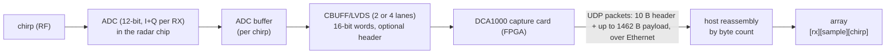
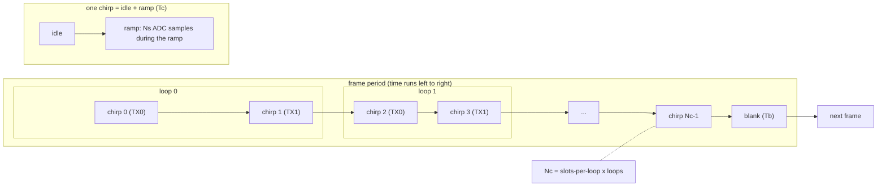
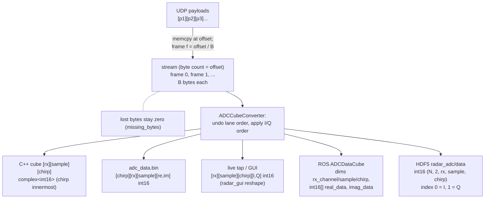

# Raw ADC data: from chirp to array

How one radar frame becomes an array in our code, for a reader who has never used an IWR1843 or a DCA1000. Per-firmware differences are on short pages (section 8). A step-by-step decode of a stock-demo frame, with a worked byte example, is section 9.

TI sources: IWR1843 data sheet (SWRS228B), mmWave SDK 3.6 user guide, xWR TRM (SWRU522E), DCA1000 user guide (SPRUIJ4A), app note SWRA581B. The PDFs in [`docs/references/`](../references/) are Git LFS pointers: run `git lfs pull` or use the ti.com links in its README. Where a statement comes from our code or a bench measurement rather than from TI, the text says so. Open questions are collected in "Unverified" at the end.

## Terms

| Term | Meaning here |
|---|---|
| R, Ns, Nc, B | RX channels enabled, ADC samples per chirp, chirps per frame, bytes per frame (or per packet, for SAR) |
| CBUFF | The on-chip block that streams the ADC buffer out of the LVDS pins |
| EDMA | The DMA engine CBUFF uses to read the ADC buffer |
| HSI | The high-speed (LVDS) interface; an "HSI header" is the optional header it prepends to a stream |
| CP / CQ | Chirp parameters / chirp quality, extra data types the radar can stream next to the ADC data |
| ping / pong | The two halves of the ADC buffer; successive chirps alternate between them |
| `chirpThreshold` | `adcbufCfg` field: chirps per ADC-buffer transfer. Must be 1 for LVDS streaming |
| slots-per-loop (cpl) | Chirp slots in one loop (`chirpCfg` indices), e.g. 2 when TX0 and TX1 alternate |
| SampleSwap | `adcbufCfg` field: I/Q order inside one complex sample (section 3) |
| ChanInterleave | `adcbufCfg` field: whether the RX channels are interleaved in the ADC buffer (1 = non-interleaved, what 2-lane devices use) |
| `dataFmt` | `lvdsStreamCfg` field: what the radar streams (0 off, 1 ADC, 2 ADC + SAR metadata, 4 CP_ADC_CQ) |
| DCA1000 data-format mode | A DCA1000 setting for the sample width (3 = 16-bit). Unrelated to `dataFmt` |
| `ADCCubeConverter` | Our C++ class that turns one assembled frame of bytes into the cube |

## 1. The pipeline in one picture

The LVDS interface on the IWR1843/6843 is a debug interface, not a production one (TI data sheet note).

## 2. Frame and chirp timing

- A frame is (chirpEnd - chirpStart + 1) chirp slots times `numLoops` (`frameCfg`); chirps leave the radar in time order.
- Samples per chirp is `numAdcSamples` (`profileCfg`).
- `chirpCfg` sets which TX fires on each chirp index. **The chirp axis of our cube counts every chirp of the frame, all TX slots included** (Nc = cpl x loops), loop-major, TX-slot-minor: chirp `c` is loop `c // cpl`, slot `c % cpl`. TI gives the per-chirp TX enable, not this array mapping; the mapping is defined in our code.
- Chirp cycle is idle time plus ramp-end time, and the frame blank is the rest of the period. The sum is not stated in TI's SDK guide; it is from our code.
- With LVDS streaming, `chirpThreshold` must be 1, so each chirp is one ADC-buffer ping or pong and one LVDS packet. Our code does not enforce this.
- The chirp-available event triggers each CBUFF transfer after the samples are complete; frame start only arms the sequence. Packets run back to back with no per-frame marker.

## 3. Sample encoding on the chip

One complex sample = 2 x int16 (little-endian, two's complement) = 4 bytes.

| SampleSwap | Lower address | Higher address | Order |
|---|---|---|---|
| 1 (stock demo) | Q | I | Q first |
| 0 | I | Q | I first |

Each int16 (16-bit container):

| Bits 15..12 | Bits 11..0 |
|---|---|
| `s s s s` (sign-extended) | `b11 ... b0`: the 12-bit ADC value |

Sign-extended, LSB-aligned: hypothesis (see Unverified).

- The receive ADC is 12-bit and complex: I and Q per RX channel.
- Over LVDS every value rides in a 16-bit container. The SDK demo supports only 16-bit and only complex output (`adcCfg 2 1`).
- The DCA1000 data-format mode must equal `numADCBits` + 1; 3 means 16-bit.
- Within a sample, the lower-address int16 is I when SampleSwap is 0 and Q when it is 1. The stock demo supports only 1, so IWR1843/6843 demo data is Q first. Measured on the IWR1843; the IWR6843/ODS order is inferred, not bench-verified.
- Studio's "IQ Swap: I first" option is described by TI for the 4-lane xWR14xx file only.
- Real-only ADC output exists in TI docs but our driver rejects it.
- Alignment hypothesis: the 12 bits are sign-extended into the 16-bit word and LSB-aligned (not shifted up by 4). Evidence: a tracked IWR1843 frame has 262 144 words, min -794, max 674, and all 16 values of (word mod 16) occur. Discriminating experiment: a clipped capture should top out near +-2047, not +-32767.

## 4. Over the LVDS lanes

IWR1843/6843, 2 lanes, SampleSwap=1. Memory units u0 u1 u2 u3 = Q0 I0 Q1 I1.

| Where | Units | Content (each row repeats: "...") |
|---|---|---|
| lane A | u0 u2 | Q0 Q1 ... |
| lane B | u1 u3 | I0 I1 ... |
| file (A0 A1 B0 B1) | u0 u2 u1 u3 | Q0 Q1 I0 I1, i.e. two Q, then two I, repeating |

- IWR1843/6843 have 2 LVDS data lanes plus a bit clock and a frame clock (DDR). The IWR1443 has 4 (see [dca1000_raw](dca1000_raw.md)).
- Data reach the pins through CBUFF, which reads the ADC buffer by EDMA. Minimum packet is 64 B. A session's size must be a multiple of 8 B; for 4 B samples this means R x Ns is even (enforced by our driver only for the SAR format).
- **A "unit"** is one 16-bit word as the chip holds it in memory. Memory order is u0 u1 u2 u3 = Q0 I0 Q1 I1 (two samples, SampleSwap 1). The two lanes split these into lane A = u0, u2 and lane B = u1, u3, so **the file holds each 8-byte group as u0 u2 u1 u3**, i.e. Q0 Q1 I0 I1. This is our code and a golden-frame measurement; TI's public docs do not state the reorder.
- Compare TI's description: in 2-lane complex non-interleaved mode lane 1 carries the real parts and lane 2 the imaginary parts of two consecutive samples, so TI's file is `I I Q Q` repeating. Same layout as ours; ours reads `Q Q I I` only because SampleSwap 1 puts Q first.
- Order in memory: chirp, then RX (lowest first), then sample.
- The 2-lane devices use the ADC buffer in non-interleaved mode only; interleaved exists only on the xWR14xx.
- With 2 lanes, exactly 3 RX cannot be captured (TI: only 1, 2 or 4); our driver does not check this.

## 5. Headers: what they carry

| Mode | Layout, in stream order |
|---|---|
| No header (`dataFmt` 1, `enableHeader` 0) | `[ ADC payload ]` |
| HSI header on | `[ data-card hdr 16 B ]` (8 B ID + 8 B length), `[ SDK hdr ]` (CBUFF session description), `[ pad ]`, `[ ADC payload ]`, `[ pad ]` |
| SAR (`dataFmt` 2) | `[ ADC payload (4 x R x Ns) ]`, `[ 2 x 32 B chirp metadata ]`; see [sar_lvds.md](sar_lvds.md): H, record fields, lane undo |

- `lvdsStreamCfg <subFrameIdx> <enableHeader> <dataFmt> <enableSW>`: `enableHeader` 1 adds an HSI header to all active streams; `enableSW` 1 adds a software session and needs `enableHeader` 1. Raw mode (no header) captures the payload only, "no header or extra bytes/padding".
- Our driver counts header bytes only for the SAR format, so **header-on captures are supported only for SAR**; every other path here uses `enableHeader` 0. The header layout (IDs `0x0CDA0ADC0CDA0ADC` and `0x09CC0CC909CC0CC9`, CP/CQ blocks) is in the appendix and is not needed to decode anything in this document.

## 6. DCA1000 to UDP

UDP datagram, raw mode (1472 B max on the wire):

| Byte offset | Width | Field | Note |
|---|---|---|---|
| 0 | 4 B | seq u32 | LE |
| 4 | 6 B | byte count u48 | LE |
| 10 | 48..1462 B | raw payload | LVDS bytes exactly as received; datagram ends at byte 1472 |

Data-separated mode adds 8 B ID + 8 B length, payload at most 1446 B.

- The DCA1000 takes LVDS in and sends UDP out. Raw mode captures all LVDS data as is; data-separated mode splits by header. Mode comes from SW2.4 or software. Our driver always asks for raw.
- Defaults: FPGA 192.168.33.180, host 192.168.33.30, command port 4096, ADC data port 4098.
- Commands are UDP packets framed `0xA55A` ... `0xEEAA`.
- A raw packet is a 4-byte sequence number, a 6-byte byte count and 48-1462 bytes of payload. TI gives no endianness and no definition of "byte count"; little-endian and "ADC bytes sent before this packet" are from our code and bench measurement.
- Our boards configure 1472 B packets, so payload is 1462 = 1472 - 10 (max UDP payload 1500 - 20 - 8 = 1472). Whether TI's size field includes the header is inferred.
- The inter-packet delay trades throughput against drops (TI default 25 us, about 325 Mbps). Our boards ship 100 us, outside TI's table.
- Loss and disorder are visible only through sequence numbers and byte counts; TI specifies no recovery. Sequence numbers start at 1 after RECORD_START.
- The capture card must be armed before the radar starts, and needs at least 12 ms of bit clock before data.

**Which raw file do you have?**

| File | What is in it | How to read it |
|---|---|---|
| Studio / DCA1000 CLI `*_Raw_0.bin`, packet headers kept | Per UDP packet: seq + length + byte count + payload | Strip the per-packet headers (place payloads by byte count), then as below |
| Studio / CLI file, payload only | The LVDS bytes in order | Start at section 7 |
| Our driver's `LVDS_Raw_0.bin` | Payload only (packet header stripped), written in arrival order, so a lost UDP packet shifts every byte after it (unlike byte-count placement); SAR: packets of B bytes, may end in a partial packet | Section 9 (demo) or [sar_lvds](sar_lvds.md) |
| Our driver's `adc_data.bin` | Already decoded: `[chirp][rx][sample][re,im]` int16, whole frames only | Nothing to undo |

## 7. Host reassembly and array axes

- A plain demo frame (dataFmt 1, no header) is B = 4 x R x Ns x Nc bytes. The tracked golden frame is 4 x 4 x 128 x 256 = 524 288 B.
- **Whole frames only.** A capture file rarely ends on a frame boundary (the SAR capture used for testing ends in a partial packet). Decode floor(len / B) frames; the converter likewise emits only whole frames (SAR: 1891 packets decoded to 1850 chirps = 37 frames x 50 chirps) and drops the trailing partial one.
- No frame marker exists in the stream, so frames are cut by counting bytes from the start of the capture.
- Each payload is copied to stream offset = its byte count, so a lost, late or duplicate packet never shifts later bytes; a payload straddling a frame boundary is split.
- A frame is emitted when complete, or when the stream is 8 packets past its end; missing bytes are zero and the frame is counted incomplete. At most two frames are open.
- A DCA1000 restart (byte counts jump back, 4 consecutive implausible packets) triggers a resync; frame indices keep increasing.
- The converter produces the cube `[rx][sample][chirp]` of `complex<int16>` with re = I, im = Q. TI has no equivalent array.
- Each output form has its own axis order on purpose (figure above); content order agrees. TI's MATLAB example uses `[rx x (chirp*sample)]`.
- For the GUI, range FFT runs over the sample axis, Doppler over loops, and the chirp axis is reshaped to `[loops, chirps-per-loop]`.

## 8. Which firmware, which page

| Firmware | Lanes | Header | Page |
|---|---|---|---|
| Stock mmw demo (IWR1843/6843/ODS) | 2 | optional | [demo](demo.md) |
| `iwr_raw_rosnode` image (IWR1443) | 4 | none | [dca1000_raw](dca1000_raw.md) |
| `iwr1843_sar_lvds` | 2 | none, metadata after payload | [sar_lvds](sar_lvds.md) |
| AWR2243 cascade DDM | - | - | No raw LVDS stream in the shipped image (`mmw_lvds_stream.c` is excluded from the build, `LVDS_STREAM` is defined nowhere, and the cascade board descriptor says `"lvds": { "supported": false }`), so there is no layout to describe. An archived firmware-repo note that describes one is marked "not verified against source"; do not rely on it |

## 9. Recipe: decode a stock-demo frame (IWR1843, SampleSwap 1, no header)

Input: R, Ns, Nc from the cfg, and one frame of B = 4 x R x Ns x Nc bytes. `decode_example.py` in this folder does exactly this.

1. **Bytes to int16.** Read the bytes as little-endian int16 (two's complement).
2. **Undo the 2-lane order.** Cut the words into groups of four (8 bytes). The file order is u0 u2 u1 u3; swap the middle two words to get memory order u0 u1 u2 u3.
3. **Pair Q and I.** SampleSwap 1: Q first. Each memory pair (u0, u1) is (Q, I) of one sample; (u2, u3) is (Q, I) of the next.
4. **Reshape** to `[chirp][rx][sample]` (memory order: chirp, then RX, then sample; Nc counts all TX slots).
5. **Output cube** `[rx][sample][chirp]` of complex, re = I, im = Q. For HDF5 (shape (N, 2, rx, sample, chirp)), I/Q is axis 1: `data[:, 0] = I`, `data[:, 1] = Q`: the pair is swapped relative to the wire (wire is Q, I; HDF5 index 0 is I).

Worked example: the first 16 bytes of `CPSL_TI_Radar_cpp/tests/data/iq/iwr1843_R0.9m_frame99.bin` (R = 4, Ns = 128, Nc = 256), decoded with `decode_example.py`.

First 16 bytes, as two 8-byte groups:

| Step | Group 1 | Group 2 | Note |
|---|---|---|---|
| bytes | `b7 00 ad 00 d3 00 51 00` | `ac 00 4a ff 0e 00 c1 ff` | |
| int16 | 183 173 211 81 | 172 -182 14 -63 | file order u0 u2 u1 u3 |
| undo | u0=183 u1=211 u2=173 u3=81 | u0=172 u1=14 u2=-182 u3=-63 | memory order |
| pairs (Q,I) | (183,211) (173,81) | (172,14) (-182,-63) | samples 0 1 (group 1) and 2 3 (group 2) of chirp 0, rx 0 |

| Result | Values |
|---|---|
| `cube[rx0][sample 0..3][chirp 0]` | 211+183j, 81+173j, 14+172j, -63-182j |
| HDF5 (I,Q) for sample 0..3 | [211,183] [81,173] [14,172] [-63,-182] |

## Unverified

- 12-bit alignment inside the 16-bit word (section 3): hypothesis, experiment named there.
- I/Q order of the IWR6843/ODS demo (inferred) and of the IWR1443 ([dca1000_raw](dca1000_raw.md)); layout of the IWR1443 with fewer than 4 RX; cascade raw LVDS (section 8; the archived note's 1456 B payload figure disagrees with TI's 1462 B, which this document uses).
- SAR packet padding: the firmware doc and the firmware descriptor disagree ([sar_lvds](sar_lvds.md)).
- Not documented in TI's public docs: SDK header field layout, CP/CQ block layouts, the `u0 u2 u1 u3` reorder, CONFIG_FPGA_GEN and CONFIG_PACKET_DATA bytes, what "byte count" counts. The mmWave Studio guide, DCA1000 CLI guide and ICD were not available when this was written.
- Header-on demo with the DCA1000: unsupported by our driver, not tested ([demo](demo.md)).

## Appendix: byte-level reference

Golden frame (IWR1843, stock demo, SDK 3.6.2): R = 4, Ns = 128, Nc = 256.

| Quantity | Value |
|---|---|
| Bytes per sample | 4 |
| Frame bytes B | 4 x R x Ns x Nc = 524 288 |
| Words per RX per chirp | Ns x 2 = 256 int16 |
| Payload per packet | 1462 B |
| Packets per frame | 524 288 / 1462 = 358.6, so frames straddle packets |

Header details (not needed for decoding; header-on captures are supported only for SAR):

- Header IDs: first stream `0x0CDA0ADC0CDA0ADC` (SDK notation, a little-endian u64), second `0x09CC0CC909CC0CC9`. The DCA1000 guide prints the same bytes in stream order of 16-bit units.
- The header is a data-card header (64-bit ID, 64-bit length with 24 valid bits) followed by an SDK header describing the CBUFF session. The SDK header's field layout is not in TI's public docs; the 16 B split is inferred from the DCA1000 guide.
- TI data types: ADC, CP, CQ and combinations. CQ carries three monitor results. Our driver cannot read CP or CQ and rejects `dataFmt` 4 for capture. A software session adds a per-frame packet the driver cannot place, so `enableSW` must be 0 for SAR.
- TI says use "multi" logging mode when the header is on; our driver always sends raw. Benign.

Fixed identifiers:

| Item | Bytes on the wire |
|---|---|
| HSI ID, HW stream | `DC 0A DA 0C DC 0A DA 0C` |
| Command header / footer | `0xA55A` / `0xEEAA` |
| Command codes | RESET 0x01, CONFIG_FPGA_GEN 0x03, RECORD_START 0x05, RECORD_STOP 0x06, SYSTEM_CONNECT 0x09, CONFIG_PACKET_DATA 0x0B, READ_FPGA_VERSION 0x0E |
